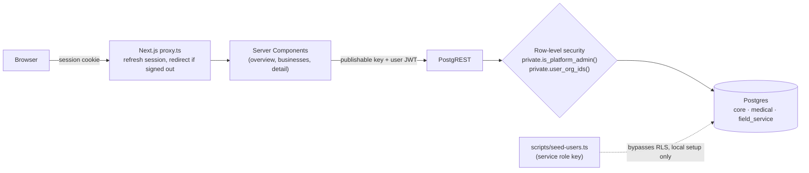
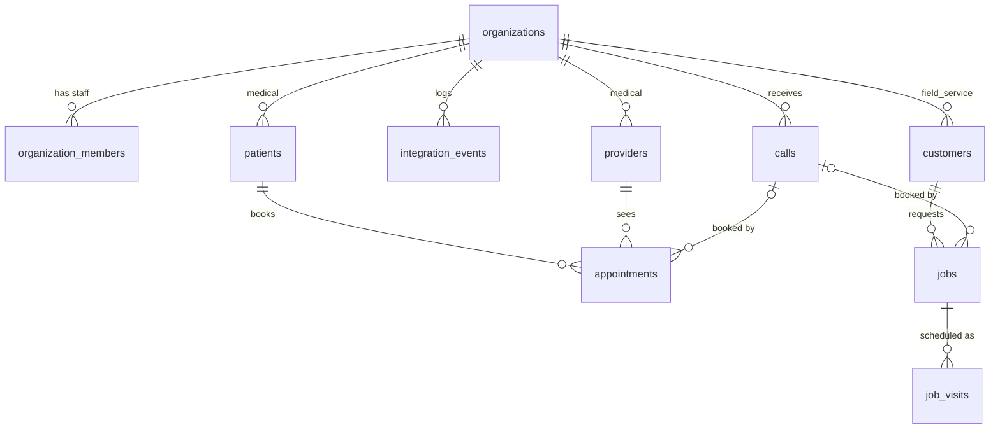

# Architecture

This document explains how the prototype is put together and why. It follows six questions: why this technology, how it supports several businesses and industries, how each business stays separate, how admin access differs from customer access, the tradeoffs, and what production would need.

## Overview



Every dashboard query runs **as the signed-in user**. The app never holds a key that bypasses security. The only place the service role key is used is the seed script.

## 1. Why this architecture and technology

**Supabase (Postgres).** iSectAI already uses Supabase, with n8n workflows connected to it. Postgres row-level security (RLS) enforces tenant isolation inside the database, and Supabase Auth issues the user identity those rules check. Switching databases would add migration cost with no clear gain at this stage.

**A hybrid schema layout.** Shared tenancy and cross-industry data live in `core`. Each industry's records live in their own schema (`medical`, `field_service`). The two industries share a lot (businesses, users, AI receptionist calls, integration events), but their records and workflows differ: a clinic has patients, providers and appointments, while an HVAC company has customers, jobs and multi-visit work orders. Separate schemas let each evolve without nullable "maybe medical" columns, and they put patient data in one place where stricter rules can be applied later.

**Next.js App Router with `@supabase/ssr`.** Server Components fetch data on the server with the user's session cookie, so no data-access code or secrets ship to the browser. Tailwind and shadcn/ui keep the UI consistent without a design system of its own.

**TypeScript with generated types.** `src/types/database.ts` is generated from the live schema, so a renamed column becomes a compile error, not a runtime bug.

## 2. Supporting multiple businesses and industries



| Schema | Tables | Purpose |
|---|---|---|
| `core` | `organizations`, `organization_members`, `platform_admins`, `calls`, `integration_events` | Tenancy, users, and data shared by every industry |
| `medical` | `providers`, `patients`, `appointments` | Clinic records |
| `field_service` | `customers`, `jobs`, `job_visits` | Service business records |
| `private` | `is_platform_admin()`, `user_org_ids()`, `set_updated_at()` | Helper functions. Never exposed through the API. |

- **`organizations.industry`** (`medical` or `field_service`) says which industry schema a business uses. The UI reads it to switch labels: Patients/Appointments or Customers/Jobs.
- **AI receptionist calls are shared.** Both industries use the same Retell integration, so `core.calls` serves both. Appointments and jobs link back to the call that booked them (`call_id`, plus `booked_via = 'ai_call'`). That link powers the "booked by AI receptionist" metric.
- **Cross-industry admin screens use views.** `core.bookings` combines medical appointments and field service job visits into one timeline with shared columns. `core.organization_overview` gives one row per business with contacts, upcoming bookings, calls this week, missed calls and AI-booked share.
- **Adding a third industry** means a new schema with its own tables, the same RLS policies, then adding a `union all` branch to `core.bookings` and a count to `core.organization_overview`.

## 3. Keeping each business separate and secure

Isolation is enforced in layers, and each layer has tests.

1. **`organization_id` on every tenant table**, `not null`, referencing `core.organizations`.
2. **RLS on every table.** Each tenant table has one read policy:
   ```sql
   using ((select private.is_platform_admin()) or organization_id in (select private.user_org_ids()))
   ```
   The helpers are `security definer` with an empty `search_path`, so they can read `platform_admins` and `organization_members` without triggering those tables' own policies (which would recurse). Wrapping them in `(select ...)` makes Postgres evaluate them once per query, not once per row.
3. **Composite foreign keys.** Parent tables declare `unique (organization_id, id)`, and children reference both columns:
   ```sql
   foreign key (organization_id, patient_id) references medical.patients (organization_id, id)
   ```
   An appointment in Clinic A can't point at a patient in Clinic B. This holds even for code that bypasses RLS, such as the service role or a future backend job.
4. **Security invoker views.** Both views are created `with (security_invoker = true)`, so they run with the caller's permissions and the underlying tables' RLS still applies. Without it, a view runs as its owner and would return every tenant's rows.
5. **Least privilege on the API.**
   - `authenticated` gets `select` only. There are no insert, update or delete grants or policies, so the dashboard is read-only for everyone.
   - `anon` has no access to any app schema.
   - `private` isn't in the API's exposed schemas, and its functions are executable only by `authenticated`, which the policies need.
6. **Tests that prove it** (`npx supabase test db`, 72 checks):
   - Clinic staff see exactly their own rows in every table and view.
   - The admin sees everything, and `anon` is denied everywhere.
   - Cross-tenant inserts fail.
   - Guard checks fail if any table lacks RLS, any view lacks `security_invoker`, or `anon` gains a privilege.

   As a sanity check, a deliberately leaky policy, RLS switched off, and a view without `security_invoker` were applied to a running database. The tests caught all three.

**The dashboard proves it end to end.** The app has no "if admin" branches in its queries. Clinic staff sign in to the same pages and see only their business. Opening another business's URL returns "not found", because RLS returns no row.

## 4. Admin vs customer access

| | Platform admin (iSectAI staff) | Organization member (clinic staff) |
|---|---|---|
| Stored in | `core.platform_admins` | `core.organization_members` (`owner` / `admin` / `staff`) |
| Checked by | `private.is_platform_admin()` | `private.user_org_ids()` |
| Sees | Every business | Only businesses they belong to |
| Writes | None in this prototype | None in this prototype |

The two roles are kept separate on purpose: a platform admin is not a member of any business. The same RLS policy grants access through either path.

**In production:**
- Put the admin flag in a **custom JWT claim** set by a Supabase Auth hook, so policies don't need a table lookup.
- Require **MFA for platform admins** (Supabase supports TOTP and the `aal2` assurance level in policies).
- Ship a **separate customer portal app** that never bundles admin code. This prototype lets clinic staff sign in to the admin app only to demonstrate isolation.
- Add **audit logging** for admin reads of patient data.

## 5. Advantages and limitations

**Advantages**
- Clear boundaries: shared concepts in `core`, industry records in their own schemas.
- Industries can evolve independently: a new field for HVAC jobs never touches clinic tables.
- Patient data sits in one schema, ready for stricter rules (column masking, audit triggers, separate grants).
- Isolation is enforced by the database and proven by tests, not by remembering to add a `where` clause.

**Limitations of the design**
- Cross-industry queries need union views, and adding an industry means updating them.
- Similar concepts exist twice: appointments and job visits are both "a booking at a time".
- More schemas to expose, grant and keep in sync.
- **Industry isn't enforced on records.** The database would accept a `medical.patients` row for an HVAC business. A composite key on `(id, industry)` or a trigger could close that gap.

**Limitations of this prototype**
- **Read-only.** There are no write paths, write policies or role-based permissions within a business (owner vs staff).
- **The AI-booked share counts visits for field service.** A job booked by AI that needs two visits counts twice.
- **The jobs tab filters by date in code**, because a job's date comes from its visits. That's fine at demo scale; it should move into a view or SQL function.
- **No pagination.** Calls show the latest 100 and activity the latest 50.
- **Seed data is relative to the reset date**, so the demo always looks current but isn't a historical record.

## 6. Production improvements

- **Compliance.** Patient data in production needs a HIPAA-eligible setup: a Supabase plan with a signed BAA, encryption review, and access policies for staff.
- **Audit logs.** Record every platform admin read of patient data (who, what, when), for example through a security definer function or `pgaudit`.
- **Retell ingestion.** Receive Retell webhooks in a Supabase Edge Function that:
  - verifies the webhook signature
  - uses `retell_call_id` as an idempotency key (it's already `unique`, so retries can't duplicate a call)
  - writes the raw payload to `integration_events` and the normalized call to `core.calls`
- **Migrations in CI.** Run `supabase db reset` and `supabase test db` on every pull request, and use Supabase branching for preview databases.
- **Backups.** Enable point-in-time recovery (PITR) on the hosted project.
- **Data growth.** Partition or apply retention to `integration_events` and `calls` by month.
- **Customer write paths.** Add insert and update policies scoped by `organization_members.role`, so owners can manage settings and staff can update bookings.
